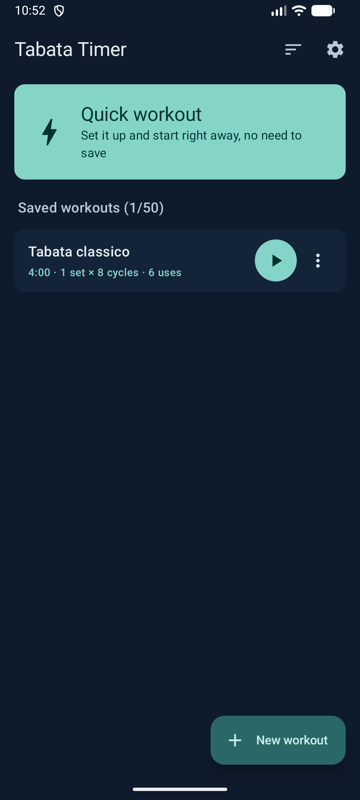
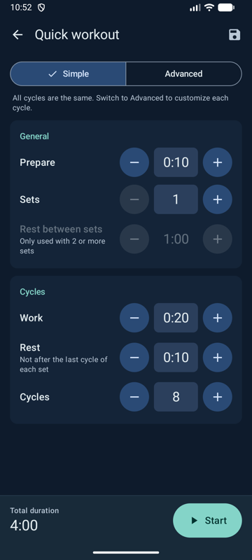
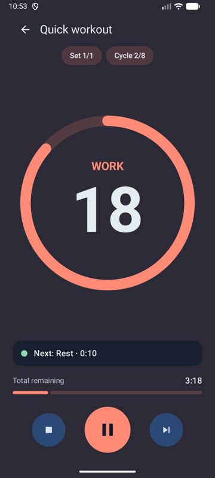

# Tabata Timer

Interval (Tabata) timer for **Android** and **iOS**: set up a workout in seconds or save your favorites, then follow the
countdown with a large display, the next activity, the total time left and audio cues. Built with Kotlin Multiplatform and
Compose Multiplatform: the whole UI and logic are written once in the [`shared`](./shared/src) module, and the platform
apps are thin entry points.

| Home | Workout editor | Run screen |
|:---:|:---:|:---:|
|  |  |  |

## Stack

- **Language:** Kotlin 2.4
- **UI:** Compose Multiplatform 1.11 with Material 3, plus type-safe `navigation-compose`
- **Persistence:** DataStore with kotlinx.serialization (JSON files)
- **Platforms:** Android 9+ (minSdk 28, targetSdk 36) and iOS 18.2+ (Apple Silicon simulators and devices)

## Architecture

Pure domain logic (workout planner, timeline, a clock based on a monotonic time source so the timer never drifts) sits apart from the UI and repositories, with manual dependency injection.
The run screen uses MVI because a running workout is a state machine with a pure, testable reducer; home, editor, settings and routines are forms and lists, so they use simpler MVVM.

## Features

- **Quick workout**: set preparation, work, rest, cycles, sets and rest between sets, then start right away without saving.
  A cycle is work + rest, except the last cycle of each set, which is work only.
- **Simple and advanced mode** in the same editor: advanced mode lets every cycle have its own name, work and rest time.
  Switching to advanced copies the simple values into each cycle; switching back asks for confirmation if the cycles differ.
- **Fast value entry**: every time/count can be changed with +/- (hold to accelerate) or by tapping the value,
  which opens a numeric keypad with timer-style entry (digits fill `m:ss` from the right) and quick presets.
- **Saved workouts**: up to 50, each with a unique name and an optional description.
- **Home list** sortable by custom order (reorder mode, move to top/bottom), name, most used, newest/oldest, shortest/longest.
  The chosen sort is remembered.
- **Run screen**: progress ring with phase colors, remaining seconds of the current activity, its name, next activity,
  total time remaining, set/cycle indicators, pause/resume, skip, stop. Audio and haptic cues (can be turned off), an optional
  warning 10 seconds before the end of an activity, screen kept on. The timer is drift-free and auto-pauses when the app goes to the background.
- **Routines** ("Schede", second tab of the bottom bar): gym routines, independent from the timer, to check and update
  while training. Up to 20 routines with unique names, up to 50 exercises each. Each exercise has name, optional
  description, sets × reps, an optional weight (half-kilo steps, same for every set) and what to do next time:
  **Increase** (with an increment, default 2 kg) or **Repeat**. The progression badge on the card toggles with a tap;
  for Increase, "Next time: 16 kg" + **Apply** updates the weight and switches back to Repeat, with Undo.
  Up to 3 routines are switched with segmented buttons, from 4 with a dropdown; the last routine shown is remembered.
  A separate screen renames, duplicates, deletes and reorders routines. Weights are typed with the same keypad,
  with a ",5" key for the half kilo.
- **Languages**: Italian and English, switchable inside the app (or following the system).
- **Theme**: light, dark or system.
- **About** section in the settings with the app version and a link to the developer website.
- App icon (stopwatch with lightning bolt) and splash screen on both platforms.

## Requirements

- A JDK to launch Gradle (Android Studio's bundled JBR works). If `java` is not on your `PATH`:
  `export JAVA_HOME="/Applications/Android Studio.app/Contents/jbr/Contents/Home"`.
  The Gradle daemon itself runs on JDK 21 (see `gradle/gradle-daemon-jvm.properties`; Gradle downloads it if missing).
- Android SDK with compileSdk 36. Android app: minSdk 28.
- Xcode for the iOS app (deployment target iOS 18.2). iOS targets are `iosArm64` and `iosSimulatorArm64` (Apple Silicon).

## Build and run

- Android debug APK: `./gradlew :androidApp:assembleDebug`
  → `androidApp/build/outputs/apk/debug/tabataTimer-<versionName>-debug.apk` (e.g. `tabataTimer-1.1-debug.apk`)
- Install on a connected device/emulator: `./gradlew :androidApp:installDebug`
- iOS app: open [`iosApp`](./iosApp) in Xcode and run it; the Xcode build invokes Gradle to produce the `Shared` framework.
- iOS compile check without Xcode: `./gradlew :shared:compileKotlinIosSimulatorArm64`

If the build fails with `Unresolved reference _collect…Resources` after adding or removing files in `composeResources`,
run `./gradlew :shared:clean` (stale generated Compose resource accessors).

## Tests

Tests live in `shared/src/commonTest` and run on both platforms:

- JVM (Android host): `./gradlew :shared:testAndroidHostTest`
- iOS simulator: `./gradlew :shared:iosSimulatorArm64Test`
- Single class: `./gradlew :shared:testAndroidHostTest --tests "com.amasesoft.tabatatimer.domain.WorkoutPlannerTest"`

## Project structure

- [`shared/src/commonMain`](./shared/src/commonMain/kotlin/com/amasesoft/tabatatimer) (package `com.amasesoft.tabatatimer`)
  - `domain/` – pure Kotlin: workout model, planner (config → steps), timeline, drift-free clock, sorting.
  - `data/` – persistence with DataStore + kotlinx.serialization (JSON files for workouts, settings and gym routines).
  - `ui/` – screens: `home`, `editor`, `run` (MVI), `settings`, `routines` (gym routines tab, manage routines,
    exercise editor); `navigation` with type-safe routes and the bottom bar.
  - `components/` – reusable composables (steppers, value-entry dialog, cards, weight formatting).
  - `theme/` – Material 3 theme, phase colors, typography.
  - `platform/` – `expect` declarations (in-app locale, keep screen on, sound/haptic cues, system bars).
  - `composeResources/` – strings (`values` English, `values-it` Italian) and vector icons.
- `shared/src/androidMain`, `shared/src/iosMain` – platform `actual` implementations.
- [`androidApp`](./androidApp) – Android entry point (`MainActivity`), launcher icon and splash theme.
- [`iosApp`](./iosApp) – SwiftUI entry point hosting the Compose UI, app icon and launch screen.
- [`design/icon`](./design/icon) – source SVGs of the app icon. If they change, regenerate the iOS PNGs and update the
  Android vector drawables (`androidApp/src/main/res/drawable/ic_launcher_*.xml`) by hand.

Dependency versions are centralized in [`gradle/libs.versions.toml`](./gradle/libs.versions.toml).

## Known limitations

- No background execution: the run pauses when the app leaves the foreground and must be resumed manually.
- Routines have no history and no workout mode: Apply overwrites the weight (Undo only right after).
